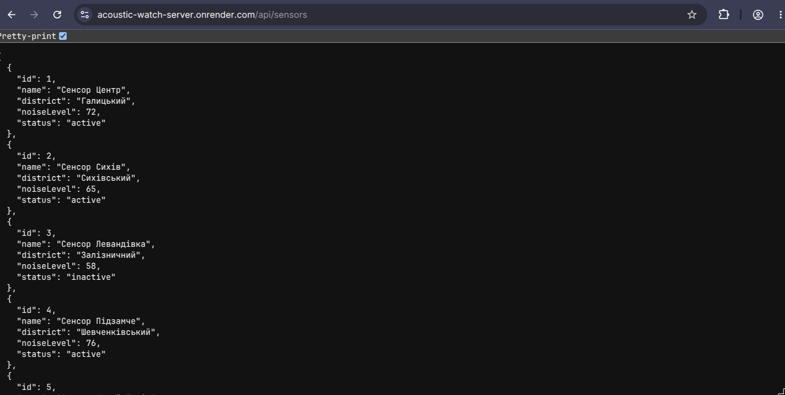
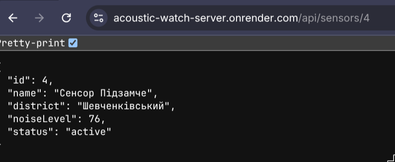
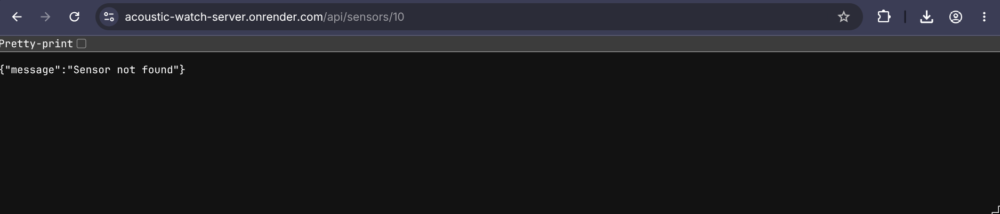

# Звіт до лабораторної роботи №10

## Тема

Розробка серверної частини застосунку «Акустична варта» на базі Node.js та Express.

## Мета роботи

Навчитися створювати REST API сервер на Node.js з використанням фреймворку Express:

- створювати Node.js-проєкт із підтримкою ES-модулів (`"type": "module"`);
- підключати та налаштовувати фреймворк Express;
- описувати структуру даних у вигляді масиву об'єктів;
- реалізовувати REST-маршрути для отримання ресурсів (`GET`);
- обробляти параметри маршруту (`req.params`) для пошуку за `id`;
- повертати відповідні HTTP-статуси (`200`, `404`) та JSON-відповіді;
- запускати сервер на заданому порті з підтримкою змінних середовища.

## Виконання роботи

- створено Node.js-проєкт з файлом `package.json`, де вказано `"type": "module"` для підтримки синтаксису `import/export`;
- підключено залежність `express` версії `^5.3.0` та встановлено через `npm install`;
- додано скрипти запуску: `start` — `node src/server.js`, `dev` — `node --watch src/server.js` для розробки без перезапуску;
- створено файл `src/data/sensors.js` із масивом об'єктів-датчиків, де кожен містить поля `id`, `name`, `district`, `noiseLevel`, `status`;
- у файлі `src/server.js` ініціалізовано Express-застосунок та підключено middleware `express.json()` для обробки JSON-тіла запитів;
- реалізовано маршрут `GET /` — повертає JSON з повідомленням про статус API;
- реалізовано маршрут `GET /api/sensors` — повертає повний масив датчиків;
- реалізовано маршрут `GET /api/sensors/:id` — отримує `id` з `req.params`, перетворює на число через `Number()`, шукає датчик методом `find()`; якщо не знайдено — повертає статус `404` з повідомленням `{ message: 'Sensor not found' }`, інакше — знайдений об'єкт;
- сервер запускається командою `app.listen(PORT, '0.0.0.0', ...)`, де `PORT` зчитується зі змінної середовища або за замовчуванням `3000`;
- сервер перевірено через браузер та інструменти тестування API.

## Структура проєкту

```
lab_10/acoustic-watch-server/
├── src/
│   ├── data/
│   │   └── sensors.js
│   └── server.js
├── package.json
└── package-lock.json
```

## Результат

Посилання на опубліковану сторінку:

https://acoustic-watch-server.onrender.com/

Скріншот відповіді маршруту `/api/sensors`:



Скріншот відповіді маршруту `/api/sensors/:id`:



Скріншот відповіді при відсутньому `id` (404):



## Висновок

Під час виконання лабораторної роботи розроблено серверну частину застосунку «Акустична варта» на основі Node.js та Express. Використано синтаксис ES-модулів завдяки параметру `"type": "module"` у `package.json`. Реалізовано три REST-маршрути: кореневий маршрут для перевірки стану API, маршрут отримання всіх датчиків та маршрут отримання датчика за ідентифікатором із відповідною обробкою випадку, коли ресурс не знайдено (HTTP 404). Параметри маршруту оброблено через `req.params` з явним приведенням типу до числа. Сервер налаштовано на прослуховування всіх мережевих інтерфейсів (`0.0.0.0`) з підтримкою порту через змінну середовища `PORT`, що забезпечує гнучкість при розгортанні.