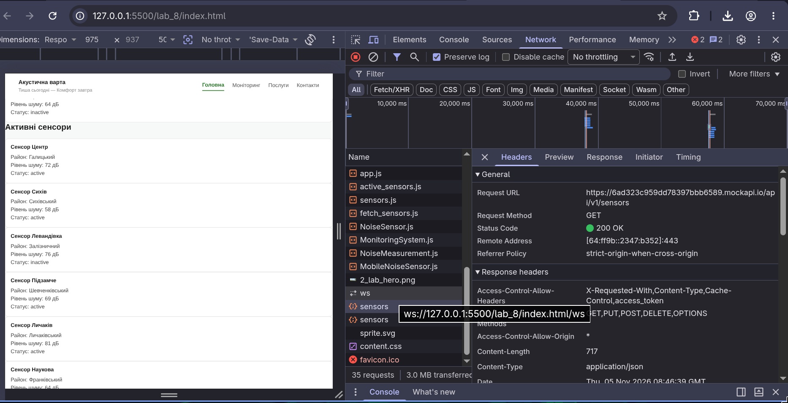

# Звіт до лабораторної роботи №8

## Тема

Робота з даними з API на TypeScript на прикладі проєкту «Акустична варта».

## Мета роботи

Навчитися отримувати дані з REST API та відображати їх у DOM засобами TypeScript:

- описувати структуру даних з API за допомогою `interface` у TypeScript;
- виконувати HTTP GET-запит за допомогою `fetch()`;
- використовувати `async/await` для асинхронного завантаження даних;
- передавати типізований масив `Sensor[]` між функціями;
- компілювати TypeScript у JavaScript через `npx tsc`;
- відображати отримані з API дані на HTML-сторінці.

## Виконання роботи

- використано MockAPI з попередньої лабораторної роботи з ресурсом `sensors` та prefix `/api/v1`;
- встановлено TypeScript через `npm install -D typescript` та ініціалізовано `tsconfig.json` через `npx tsc --init`;
- налаштовано `tsconfig.json` з параметрами `rootDir: ./src` та `outDir: ./dist`;
- додано `.gitignore` з виключеннями `node_modules/` та `dist/`;
- створено папку `src` та файл `src/sensors.ts`;
- описано `interface Sensor` з полями `id`, `name`, `district`, `noiseLevel` (number), `status` ("active" | "inactive");
- реалізовано функцію `renderSensors(sensors: Sensor[]): void` — знаходить контейнер `#sensors` через `document.querySelector<HTMLDivElement>()`, перевіряє його наявність, очищує через `innerHTML = ""` та створює картки через `forEach()`;
- реалізовано асинхронну функцію `loadSensors(): Promise<void>` — виконує GET-запит через `fetch()`, перевіряє `response.ok`, типізує відповідь як `Sensor[]` та передає у `renderSensors()`;
- додано обробку помилок через `try/catch` та виведення в `console.error`;
- `loadSensors()` викликається автоматично в кінці файлу;
- скомпільовано TypeScript командою `npx tsc` — створено `dist/sensors.js`;
- у `index.html` підключено `./dist/sensors.js` з атрибутом `type="module"`;
- у DevTools → Network підтверджено GET-запит до `sensors` зі статусом 200/304.

## Структура проєкту

lab_8/
├── index.html
├── css/
├── scss/
├── src/
│ └── sensors.ts
├── dist/
│ └── sensors.js
├── js/
│ ├── models/
│ │ ├── NoiseSensor.js
│ │ ├── NoiseMeasurement.js
│ │ └── MobileNoiseSensor.js
│ ├── services/
│ │ └── MonitoringSystem.js
│ ├── active_sensors.js
│ ├── fetch_sensors.js
│ └── app.js
├── package.json
├── tsconfig.json
└── .gitignore

## Результат

Посилання на опубліковану сторінку:

https://quzay.github.io/Web/lab_8/index.html

Скріншот Network у DevTools:

## Висновок

Під час виконання лабораторної роботи реалізовано завантаження даних із публічного REST API та їх відображення у DOM засобами TypeScript. Описано `interface Sensor` для типізації даних з API. Використано `fetch()` для GET-запиту, `response.ok` для перевірки відповіді та `response.json()` з типом `Sensor[]` для перетворення JSON. Функції розділено за відповідальністю: `loadSensors()` отримує дані, `renderSensors()` відображає їх. TypeScript скомпільовано у JavaScript командою `npx tsc`, браузер підключає згенерований `dist/sensors.js`. Запит перевірено у DevTools → Network.