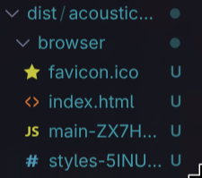
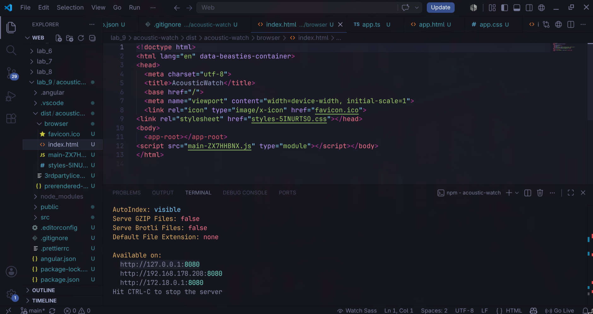
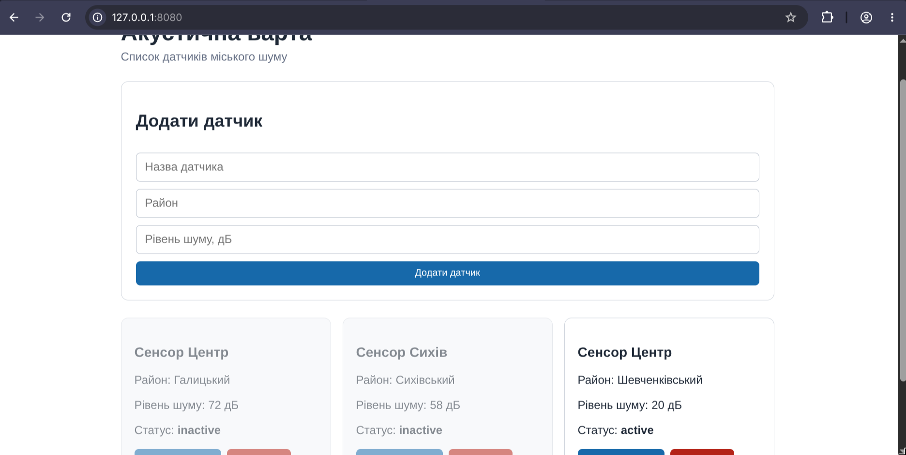

# Звіт до лабораторної роботи №9

## Тема

Розробка Angular-застосунку на прикладі проєкту «Акустична варта».

## Мета роботи

Навчитися створювати Angular-застосунки зі standalone-компонентами, реактивними формами та динамічним відображенням списків:

- створювати Angular-проєкт за допомогою Angular CLI;
- описувати структуру даних через `interface` у TypeScript;
- використовувати standalone-компоненти та `FormsModule`;
- застосовувати двостороннє зв'язування даних через `[(ngModel)]`;
- відображати списки через `@for` / `@empty` у шаблонах Angular 17+;
- реалізовувати додавання, видалення та перемикання стану елементів списку.

## Виконання роботи

- створено Angular-проєкт командою `ng new acoustic-watch --standalone`;
- описано `interface Sensor` з полями `id`, `name`, `district`, `noiseLevel` (number), `status` ("active" | "inactive");
- у компоненті `App` оголошено масив `sensors: Sensor[]` з трьома початковими датчиками — «Сенсор Центр» (Галицький), «Сенсор Сихів» (Сихівський), «Сенсор Левандівка» (Залізничний);
- підключено `FormsModule` у `imports[]` standalone-компонента для підтримки `[(ngModel)]`;
- реалізовано метод `addSensor()` — валідує поля `newName`, `newDistrict`, `newNoiseLevel`, генерує `id` через `Math.max()` та додає новий об'єкт у масив;
- реалізовано метод `deleteSensor(id)` — фільтрує масив `sensors`, виключаючи елемент з відповідним `id`;
- реалізовано метод `toggleStatus(id)` — знаходить датчик через `find()` та перемикає `status` між `'active'` і `'inactive'`;
- у шаблоні `app.html` використано `@for (sensor of sensors; track sensor.id)` для відображення карток та `@empty` для повідомлення при порожньому списку;
- застосовано `[class.inactive]` для стилізації неактивних датчиків;
- у `tsconfig.app.json` додано `rootDir: "./src"` для усунення попередження TypeScript;
- застосунок запущено командою `ng serve` та перевірено на `http://localhost:4200/`.

## Структура проєкту

```
lab_9/acoustic-watch/
├── dist/acoustic-watch/
│ └── browser/
│ └── index.html
├── src/
│ └── app/
│ ├── app.ts
│ ├── app.html
│ ├── app.css
│ └── sensor.ts
├── angular.json
├── tsconfig.json
├── tsconfig.app.json
└── package.json
```

## Результат

Скріншот папки dist/acoustic-watch/browser:



Скріншот файлу index.html:



Скріншот production-версії застосунку:



Посилання на опубліковану сторінку:

https://quzay.github.io/Web/lab_9/acoustic-watch/dist/acoustic-watch/browser/


## Висновок

Під час виконання лабораторної роботи розроблено Angular-застосунок «Акустична варта» для відображення та керування списком датчиків міського шуму. Використано standalone-компоненти Angular без NgModule, що спрощує архітектуру проєкту. Підключено `FormsModule` для двостороннього зв'язування через `[(ngModel)]`. Описано `interface Sensor` для типізації даних. Реалізовано три операції: додавання датчика з валідацією полів, видалення через `filter()`, перемикання статусу через тернарний оператор. Для відображення списку використано вбудований блок `@for` з відстеженням за `track sensor.id` та блок `@empty` для порожнього стану. Динамічне застосування CSS-класу `[class.inactive]` забезпечує візуальне розрізнення активних і неактивних датчиків. Виконано production build та опубліковано застосунок через GitHub Pages.